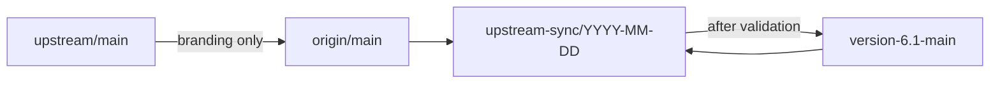

# Upstream synchronization

Standing procedure for bringing Sim upstream into this fork. The current seam inventory for the 6.1 gap is [version-6.1-main-vs-main.md](version-6.1-main-vs-main.md). This document is the procedure. That report is the file-by-file map for the current merge. Do not treat a sync as conflict resolution.

The objective is to keep as much upstream functionality as practical, preserve required Arena behavior, and make the next sync smaller than this one.

## Branches

| Remote | Branch | Role |
|---|---|---|
| `upstream` (`simstudioai/sim`) | `upstream/main` | Read-only Sim. Never commit to it. |
| `origin` (`arenadeveloper02/p2-sim`) | `origin/main` | Intake. Sim `main` plus branding (logos and the docs title). Not the product. |
| `origin` | `version-6.1-main` | Current product branch. Arena behavior lives here. |
| `origin` | `upstream-sync/YYYY-MM-DD` | Integration branch, cut from `version-6.1-main`. |

There is no `version-6.1-prod`. Older lines (`version-5-prod`, `v2-main-prod`, `release/prod`) are not the sync target. When the product line is renamed, update this file and `.claude/rules/upstream-sync.md`, then run `bun run skills:sync`.

Local `main` is stale. After `git fetch`, use `origin/main`.



The product sync merges `origin/main` into the integration branch. `origin/main` must already contain the upstream commits you intend to take, with only branding kept on top. Merging `upstream/main` straight into `version-6.1-main` skips that branding. Do not sync on `main` or directly on `version-6.1-main`.

## Principles

1. When upstream edits a file that also contains Arena behavior, do not accept theirs, accept ours, replace the file, or keep whichever side is newer. Read both changes, see whether they touch the same behavior, and keep required Arena behavior on upstream's structure.
2. When an upstream change does not affect required Arena behavior, take upstream. That includes unrelated features, bug fixes, refactors, and performance work.
3. When both sides implement a similar feature, compare behavior before choosing. Same name is not the same feature. Compare the problem each one solves, the API, the data model, edge cases, security, configuration, compatibility, and what would be lost by dropping ours. Then classify:
   - **Adopt upstream** when it is equivalent or better, and remove the duplicate where that is safe.
   - **Combine** when upstream is the right base and Arena still needs a specific behavior. Keep only that behavior.
   - **Keep custom** when upstream does not meet the requirement. Record why in the sync report.
   - **Replace custom** when upstream fully supersedes ours. Remove the obsolete code and its tests.
4. Preserve the required behavior, not the current implementation. If upstream replaces implementation A with implementation B, re-implement the required behavior on B.
5. Prefer a wrapper that calls upstream's current file over an edit inside upstream's function. A new module plus a one-line registration is that wrapper when the feature is exclusive. Product name and logo go through `apps/sim/ee/whitelabeling`. If the same file conflicts on the next sync, extract the seam. The stuck list in the gap report is the set that will collide again until that extraction happens.

## Classify each overlap

| Category | Situation | Action |
|---|---|---|
| 1. Independent upstream change | No interaction with Arena behavior | Adopt upstream |
| 2. Same file, different behavior | Both changes can coexist | Merge both. Keep upstream's control flow |
| 3. Same functionality | Upstream implemented something Arena already customized | Semantic comparison above. Do not resolve automatically |
| 4. Upstream refactor | Upstream moved code that contains Arena behavior | Port the behavior onto the new structure |
| 5. Behavioral conflict | Upstream contradicts a required product behavior | Keep the required behavior. Take unrelated upstream improvements |
| 6. Obsolete customization | Upstream fully covers the requirement | Remove the custom code after checking that no required behavior is lost |

On files only upstream changed since the merge-base, take upstream. Exclusive Arena trees come back as new files. Registries (`apps/sim/blocks/registry-maps.ts`, `apps/sim/tools/registry.ts`, `integrations.json`) take upstream, then re-register exclusive entries.

## Workflow

### 1. Read the repository before editing

Record `git status`, the current branch, both remotes, and how far `version-6.1-main` and `origin/main` have diverged from each other and from `upstream/main`. Find the merge-base. Do not modify the worktree until that picture is written down.

If `origin/main` is behind `upstream/main`, stop the product sync and update the intake branch first: take upstream, keep branding only. Then cut the integration branch.

### 2. Fetch

```bash
git fetch upstream
git fetch origin
```

`upstream/main` stays read-only.

### 3. Integration branch

```bash
git switch -c upstream-sync/YYYY-MM-DD origin/version-6.1-main
git merge origin/main
```

Use the fetched tips. Inspect the upstream range before resolving overlaps: commit count, files, features, refactors, API changes, schema changes, dependency changes, and files that also contain Arena edits. Prioritize those overlaps. The gap report's conflict index is the default class per area for the current merge.

### 4. Identify Arena customizations

Use history, commit messages, tests, project config, and `git log -S` / `git log -G` before changing a difference you do not understand. A difference that is not documented can still be intentional.

### 5. Resolve the smallest possible region

Keep upstream's structure. Insert only the Arena behavior that is still required. Do not reformat, rename, reorder imports, or restyle unrelated code. Do not rewrite a function to make the conflict easier to read.

Do not run `git checkout --ours` or `git checkout --theirs` for a conflict unless the person running the sync explicitly asks for that. Resolving a large conflict by taking one side entirely requires confirmation.

### 6. Diff output contracts

A clean merge does not mean saved workflows still run. Workflows store references such as `<BlockName.field>` against the object the tool returns. Upstream can rename, remove, or retype that field in a file this fork never edited, so Git reports no conflict. Existing block tests only check that the new schema is internally consistent.

`getBlockOutputs` is what the editor offers. `tool.outputs` is what a run produces. Trigger outputs are a third contract. A workflow fails when a path it already references is no longer produced.

On `version-6.1-main`, before the merge:

```bash
bun run apps/sim/scripts/diff-block-output-contracts.ts dump --out /tmp/output-contracts-before.json
```

On the integration branch, after the tree resolves:

```bash
bun run apps/sim/scripts/diff-block-output-contracts.ts diff /tmp/output-contracts-before.json
```

The script compares block type, operation, path, type, and source (`block`, `tool`, or `trigger`). Added paths are safe. Removed paths and type changes are breaking. A removed path plus a new path with the same leaf name, on the same block, operation, and source, is a rename candidate. The command exits non-zero when anything breaking remains.

A breaking row blocks the sync until one of these is true:

- A compatibility alias still writes the old key from the new value, so existing `<BlockName.oldField>` references resolve. Hide the alias from the editor when the new field is the one builders should pick. A type change cannot be fixed with an alias.
- The sync report names the path and records that no saved workflow references it.

When a database is available, scan stored workflow state for the breaking paths. Each block has a `type`. Downstream subblock values hold `<Name.path>` references. Match the path to that block's type and selected operation. The contract diff says the output changed. The scan says which workflows will fail.

Input fields are the same class of break, and they already have a check. Subblock id removals must be mapped in `SUBBLOCK_ID_MIGRATIONS` (`apps/sim/lib/workflows/migrations/subblock-migrations.ts`). Run it against the pre-sync product tip:

```bash
bun run apps/sim/scripts/check-block-registry.ts version-6.1-main
```

Record subblock id failures in the same report section as output contract changes.

### 7. Verify

Use `bun` and `bunx`. Run `bun run type-check`, `bun run check:api-validation`, and the tests that cover each affected customization. Run the build and integration or e2e tests when the sync touches those paths.

When a test fails, decide whether the cause is an upstream behavior change, a bad merge, obsolete Arena code, a dependency change, or an intentional product difference. Do not edit a test so that it passes. Tests that encode required product behavior stay.

### 8. Report

Write the sync report below before calling the sync done. Merge the integration branch into `version-6.1-main` only after that report and the verification above.

## Fork-specific constraints

- **Database.** Do not replay Arena migrations that reuse upstream's numeric filenames. Those numbers already mean different changes. Rebuild custom tables on upstream's current schema. Regenerate `packages/db/migrations/meta/*_snapshot.json`. Do not delete an upstream migration. Do not hand-merge generated snapshots. Resolve the source, run the generator, then read the output.
- **Dependencies.** Read version bumps, breaking changes, peer dependencies, and security updates. Do not downgrade an upstream dependency only to make a conflict disappear.
- **APIs.** Adapt Arena code to the new upstream API. Keep a compatibility surface when an external consumer still depends on the old one.
- **UI.** Take upstream's component structure. Re-apply Arena as the minimum: labels, a hub return link, an org-admin gate, and behavior that whitelabeling cannot express.
- **Generated files.** Do not hand-merge them.

## Before removing Arena behavior

Record why the customization exists, whether the requirement still exists, whether upstream now covers it, and whether removal changes observable behavior. If the reason is unclear, leave the code and flag it in the report.

## Commits

Use the repository's conventional commit style. Name the Arena behavior in the message when a commit preserves or changes it. Do not invent a parallel customization id scheme, and do not rewrite history to add one. The sync report is the record of each decision.

## Sync report

```text
## Upstream sync report

### Upstream
Previous upstream commit:
New upstream commit:
origin/main:
Integration branch:

### Summary
Upstream commits:
Files changed:
Conflicts:
Output contract breaks:
Subblock id breaks:

### Customizations affected
| Customization | Upstream impact | Decision | Reason |
|---|---|---|---|

### Output contract changes
| Block | Operation | Path | Source | Change | Decision |
|---|---|---|---|---|---|

Decision is `alias` (old key still written), `accept` (no saved workflow references it), or `blocked`.

### Subblock id changes
List ids removed without a SUBBLOCK_ID_MIGRATIONS entry, and the migration added for each.

### Important changes
Upstream changes that can affect the product.

### Removed customizations
Arena behavior removed because upstream now covers it.

### Remaining divergence
Intentional differences from upstream.

### Tests
Build:
Type check:
Unit tests:
Integration tests:
E2E tests:
Output contract diff:
Subblock id check:

### Manual review required
Anything that is not resolved.
```

## Safety

Stop and ask before:

- deleting significant Arena functionality
- dropping or renumbering migrations
- changing production behavior or a public API
- force pushing or rewriting shared history
- resolving a large conflict by taking only one side
- removing a customization whose purpose is unclear
- shipping a sync that still has a breaking output path or an unmapped subblock id

## Done

A sync is done when the required upstream changes are in, required Arena behavior still holds, obsolete duplicates are gone, new upstream behavior was adopted where it fits, tests pass, output and subblock contracts are either compatible or explicitly accepted, and the remaining differences are listed in the report. The result should be easier to sync next time.
